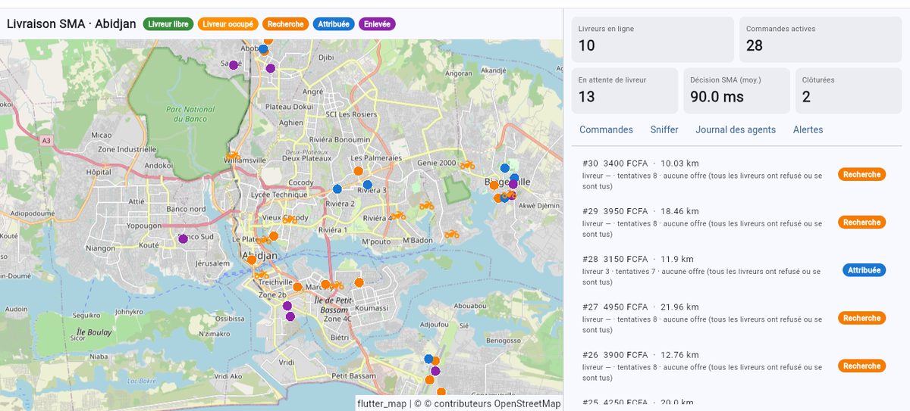
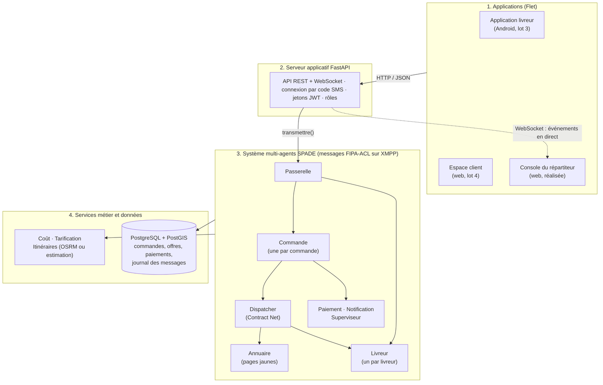
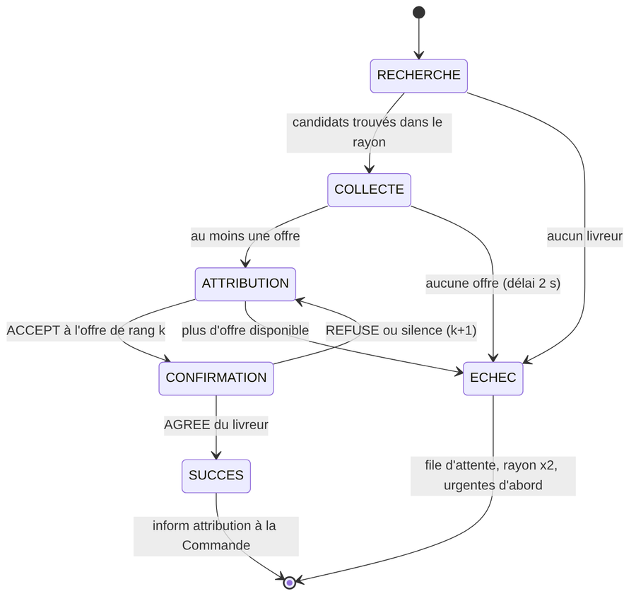
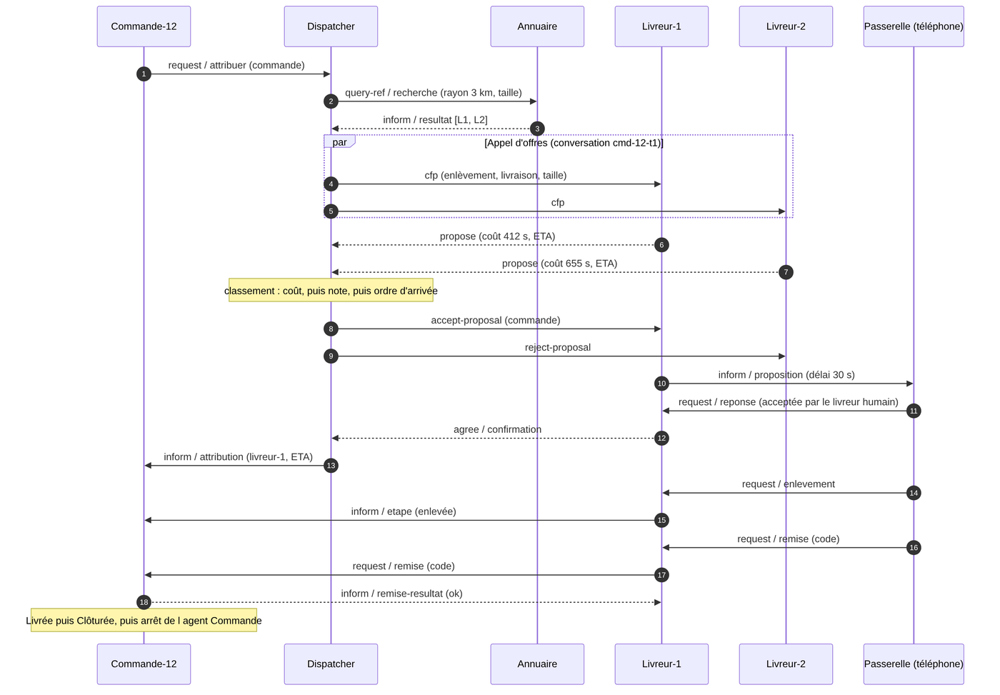
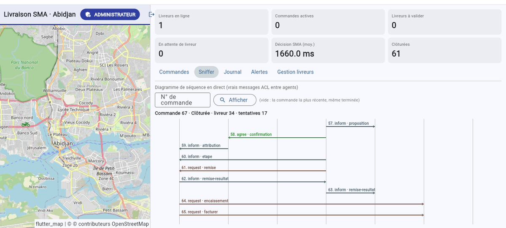
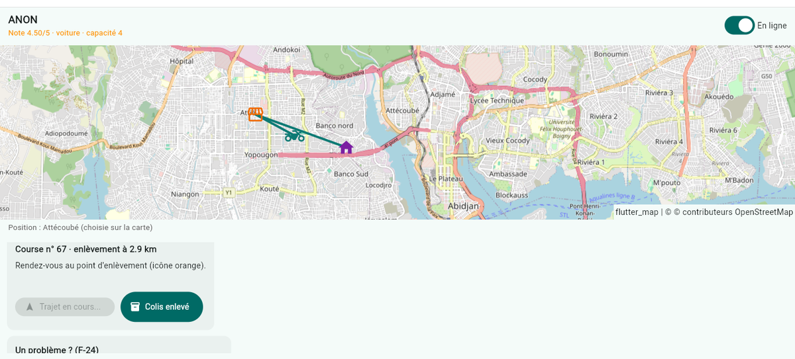
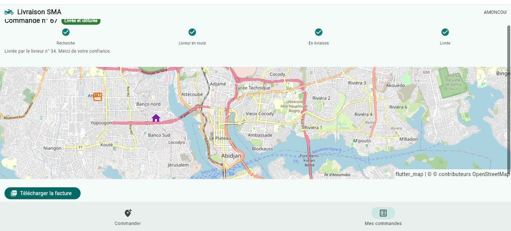
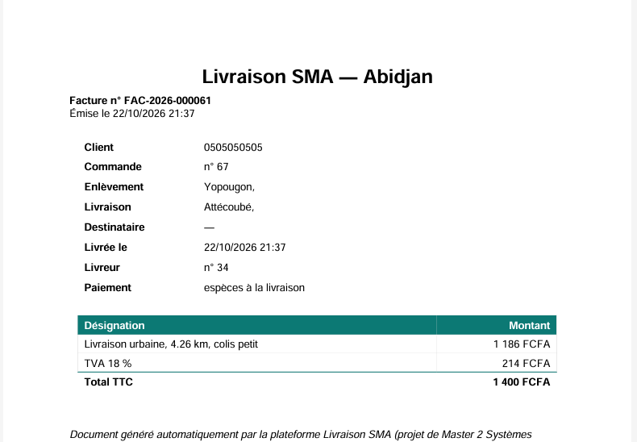
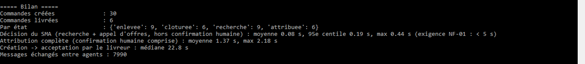

# Livraison SMA — Abidjan

**Plateforme de livraison urbaine pilotée par un système multi-agents.** Chaque commande est attribuée par un appel d'offres (protocole *Contract Net*) entre agents SPADE qui négocient en messages FIPA-ACL. Le Dispatcher réagit aux refus, aux silences, aux pannes et aux pertes de GPS sans intervention humaine.

Projet du Master 2 Systèmes multi-agents, réalisé en Python : SPADE · FastAPI · PostgreSQL/PostGIS · Flet.

> 🎥 Vidéo de démonstration : *lien YouTube à venir*



## En chiffres

| | |
|---|---|
| Décision du système multi-agents | **0,08 s** en moyenne (exigence : moins de 5 s) |
| Test de charge | 200 commandes simultanées, 100 livreurs : **200 livrées sur 200** |
| Démonstration de robustesse | **5 scénarios sur 5** réussis (refus, silence, panne, file d'attente, GPS coupé) |
| Tests automatisés | **45 tests**, dont 16 scénarios de la recette |
| Messages entre agents | près de 8 000 sur une simulation de 30 commandes, tous visibles dans le Sniffer |

## Les agents



| Agent | Rôle |
|---|---|
| **Dispatcher** | Mène l'appel d'offres (`FSMBehaviour`) : recherche, collecte des offres, attribution, confirmation |
| **Livreur** | Un agent par livreur connecté ; calcule son offre (temps d'arrivée + charge) et négocie pour lui |
| **Commande** | Un agent par commande ; suit son cycle de vie jusqu'à la clôture |
| **Annuaire** | Pages jaunes : livreurs en ligne, position, disponibilité ; recherche par rayon |
| **Superviseur** | Surveille les GPS muets et les commandes bloquées, déclenche les réattributions |
| **Paiement**, **Notification** | Encaissement, facture PDF, messages au client |
| **Passerelle** | Pont entre l'API (applications) et le monde des agents |

### Le Contract Net du Dispatcher

| Automate du Dispatcher | Séquence des messages |
|---|---|
|  |  |

- **Coût d'une offre** = temps pour rejoindre l'enlèvement + 300 s par course déjà en charge. À égalité : la meilleure note, puis l'offre arrivée la première.
- **Rayon de recherche** : 3 km, doublé à chaque nouvel essai jusqu'à 25 km. Nouvel essai toutes les 10 s, les commandes urgentes d'abord.
- **Confirmation humaine** : le livreur dispose de 30 s pour accepter. S'il refuse ou se tait, le Dispatcher passe à l'offre suivante.

### Le Sniffer : le Contract Net en direct

La console affiche les vrais messages ACL échangés pour n'importe quelle commande, sous forme de diagramme de séquence.



## Les trois applications

| Livreur : proposition, trajet, remise par code | Client : commande, suivi, facture |
|---|---|
|  |  |

La **console** (répartiteur et administrateur) réunit la carte en direct, les commandes, le journal des agents, les alertes, la validation des livreurs et leur relevé de gains.

Facture PDF générée automatiquement :



**Tarif** : 500 FCFA + 150 FCFA/km, majoré de 20 % la nuit et de 50 % pour une urgence, minimum 700 FCFA. TVA 18 %, commission de la plateforme 20 %.

## Démarrage rapide

Prérequis : Python 3.11 à 3.13 (3.14 est encore trop récent pour certaines bibliothèques), Docker Desktop, Git. L'installation complète pour Windows, Ubuntu et Debian est décrite dans **[docs/INSTALLATION.md](docs/INSTALLATION.md)**.

```bash
git clone https://github.com/leconcret/livraison-sma.git
cd livraison-sma
python -m venv .venv
.venv\Scripts\activate          # Windows  (Linux : source .venv/bin/activate)
pip install -r requirements.txt -e .
copy .env.example .env          # Windows  (Linux : cp .env.example .env), puis changer les mots de passe
docker compose up -d            # PostgreSQL/PostGIS + Redis
```

Puis, dans trois terminaux :

```bash
python -m livraison.lancer --demo 15            # 1 : serveur XMPP + API + agents + 15 livreurs simulés
python -m livraison.interfaces.console --web    # 2 : console → http://127.0.0.1:8550
python -m livraison.interfaces.client --web     # 3 : client  → http://127.0.0.1:8551
```

Le numéro du répartiteur est `0700000001` et celui de l'administrateur `0700000000`. En mode développement, le code « SMS » est rempli automatiquement. L'application du livreur se lance avec `python -m livraison.interfaces.livreur --web` (port 8552), et l'API est documentée sur http://127.0.0.1:8000/docs.

Sans Docker : `python -m livraison.lancer --memoire --demo 15`.

### Démonstration de robustesse

```bash
python -m livraison.lancer --memoire --rapide          # terminal 1
python -m livraison.interfaces.console --web           # terminal 2 : onglet « Sniffer »
python -m livraison.simulation.robustesse --rapide     # terminal 3 : les 5 scénarios commentés
```

1. Un livreur décline : le Dispatcher retient l'offre suivante.
2. Un livreur ne répond pas : délai dépassé, offre suivante.
3. Panne après l'enlèvement : message FAILURE, nouvel appel d'offres sans ce livreur.
4. Aucun livreur disponible : file d'attente, puis attribution dès qu'un livreur se connecte.
5. Téléphone éteint en course : alerte GPS, puis réattribution.

### Tests

```bash
pytest
```



## Organisation du code

```
src/livraison/
├── agents/        les 8 agents SPADE et l'orchestrateur du système
├── api/           API FastAPI (JWT, 4 rôles, WebSocket)
├── donnees/       PostgreSQL/PostGIS ou mémoire
├── interfaces/    console, client, livreur (Flet)
├── modele/        entités, états d'une commande, géographie, coût d'une offre
├── services/      tarification, itinéraires, facturation
└── simulation/    simulateur de livreurs et de clients, démonstration de robustesse
docs/              conception (diagrammes), guide d'installation, captures
tests/             45 tests
```

Le dossier de conception, avec les cas d'utilisation, les états d'une commande, le modèle de données et les séquences d'exception, se trouve dans [docs/CONCEPTION.md](docs/CONCEPTION.md).

## Auteur

**leconcret** — Master 2 Systèmes multi-agents, 2026.
