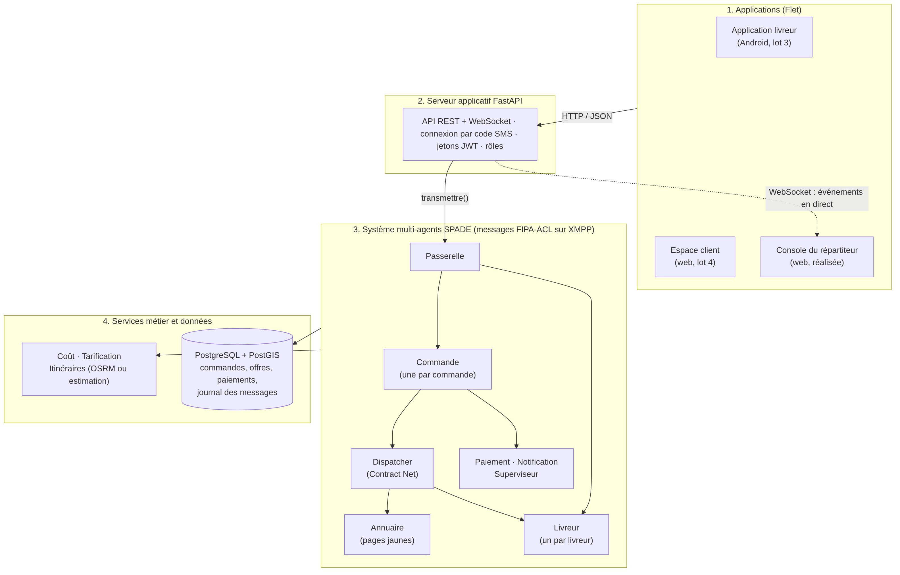
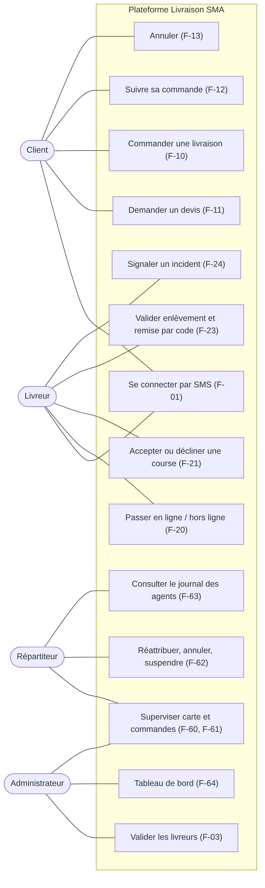
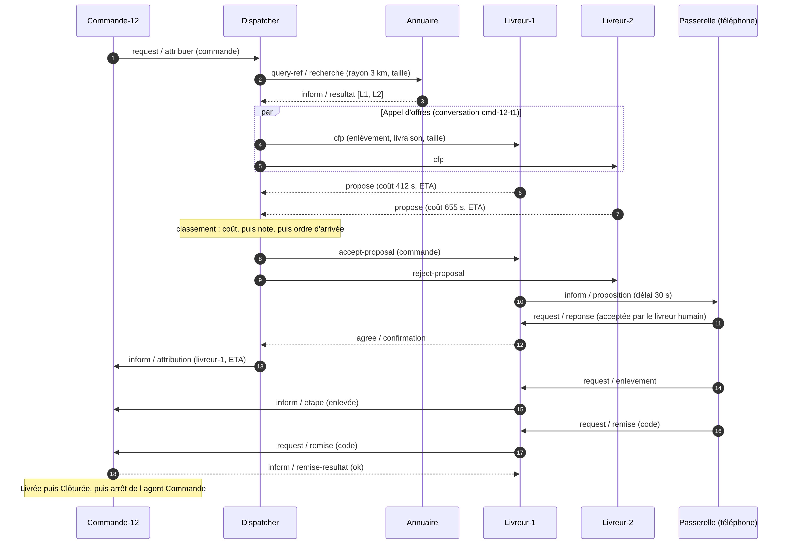
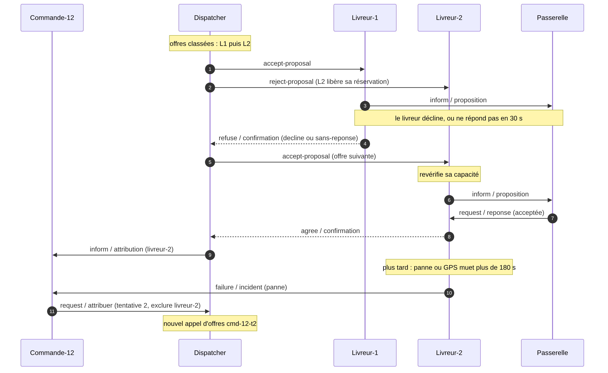
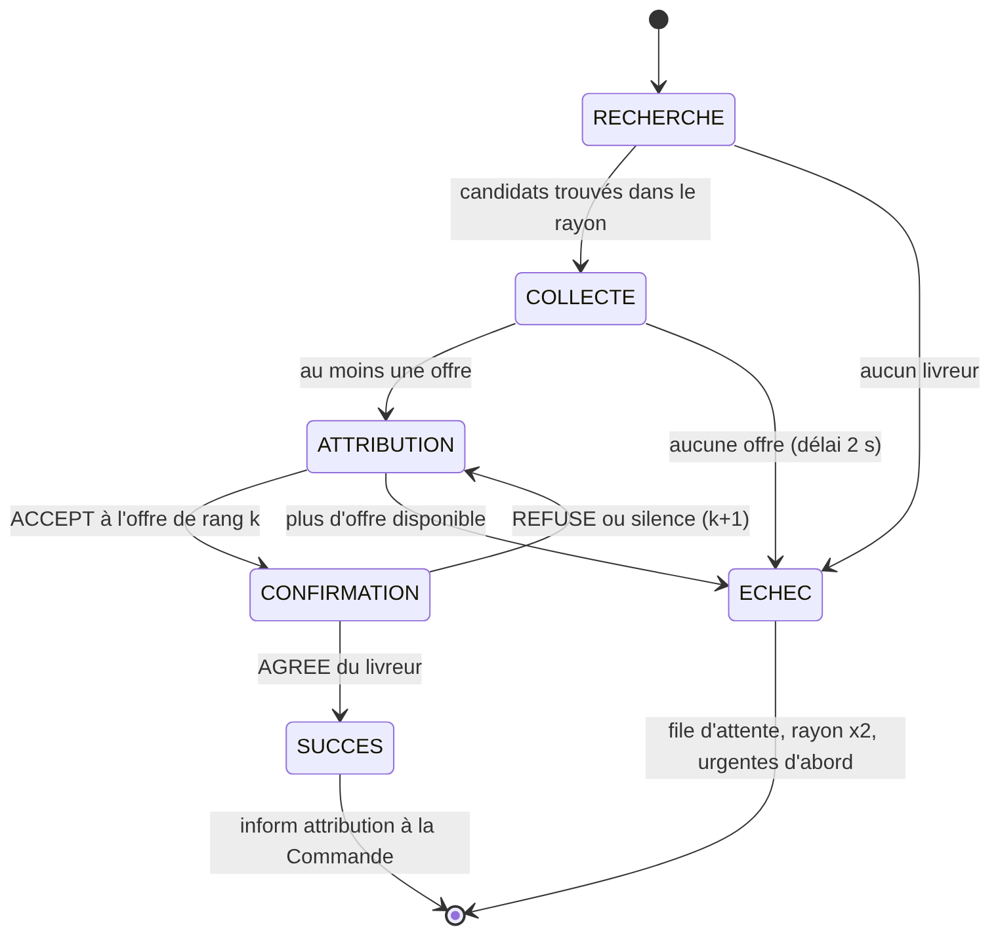
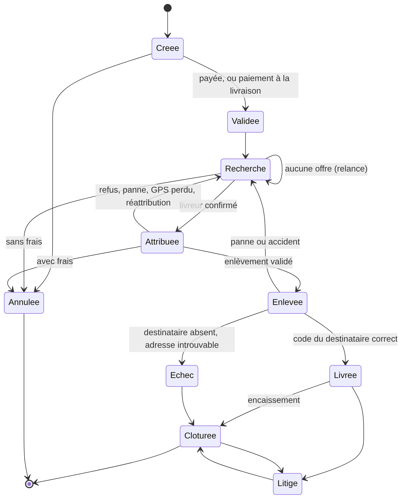
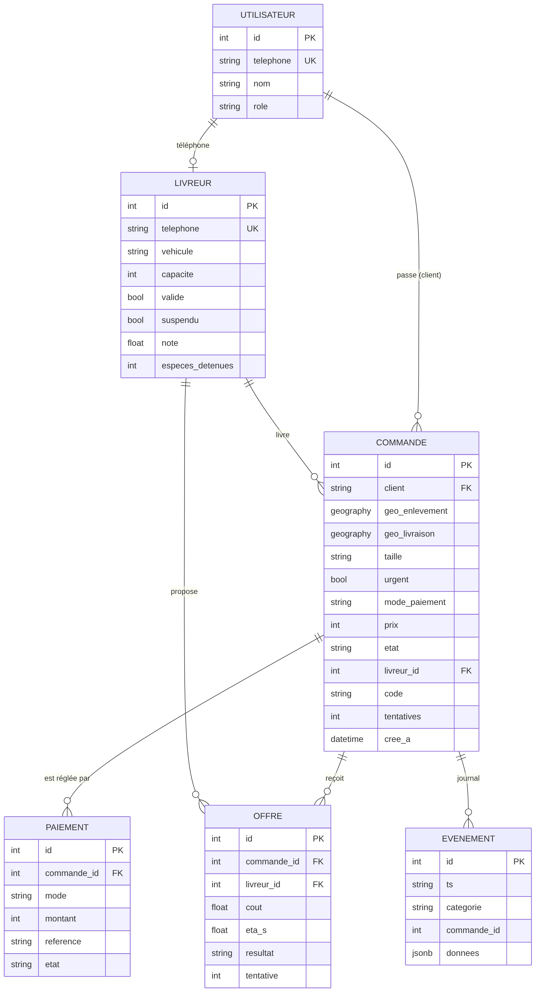
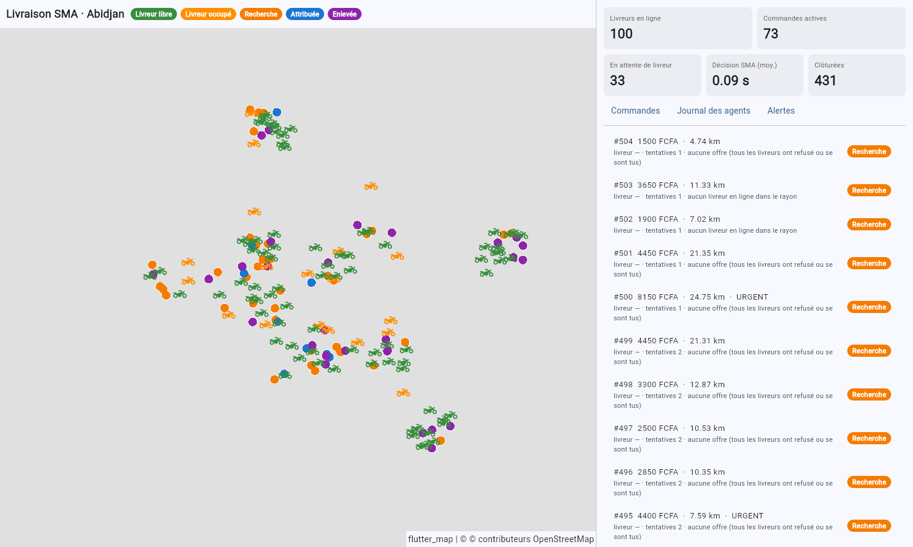
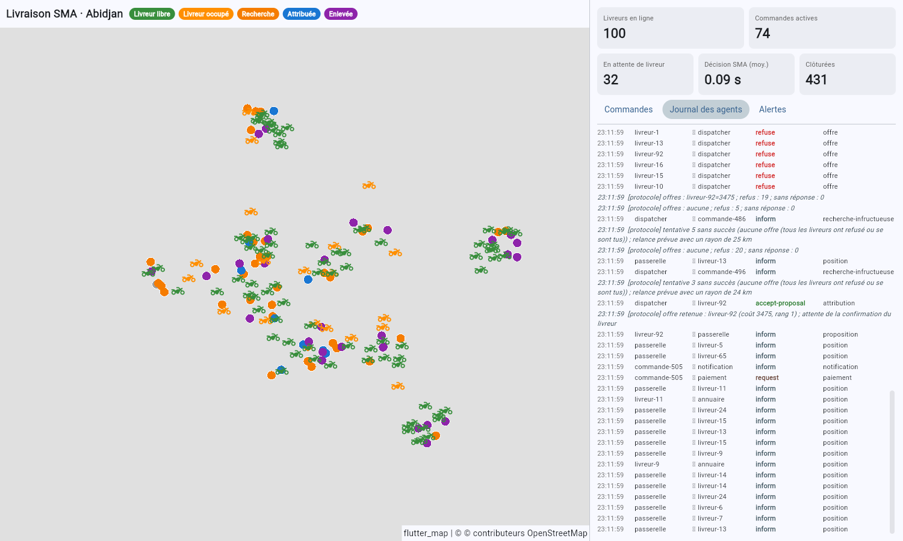
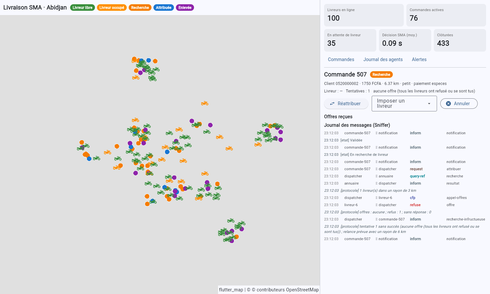

# 1. Objet du document

Ce dossier répond au livrable « dossier de conception » du cahier des charges (§ 8.1). Il décrit la version 0.2 du projet : le **socle technique (lot 1)** et le **cœur multi-agents (lot 2)**. Il inclut aussi une première **console du répartiteur** (début du lot 6) et un **simulateur** de livreurs et de clients, qui sert à la démonstration et au test de charge de la recette.

| Lot | Contenu | État dans la version 0.2 |
|---|---|---|
| 1 · Conception et socle | Environnement, base de données, authentification, SPADE et XMPP | **Réalisé** |
| 2 · Cœur multi-agents | Annuaire, Dispatcher, agents Livreur et Commande, Contract Net, tests | **Réalisé** |
| 3 · Application livreur | GPS, propositions, guidage, validation | API prête ; application Android à faire |
| 4 · Espace client | Commande sur carte, prix, suivi | API prête ; interface à faire |
| 5 · Paiement et facturation | Mobile money, espèces, factures | Dialogue entre agents en place, prestataire simulé |
| 6 · Supervision | Console, administration, tableau de bord | **Console du répartiteur réalisée** |
| 7 · Optimisation et robustesse | Tournées, reprise, charge | Reprise après redémarrage et test de charge réalisés |

# 2. Architecture

Le découpage suit le § 7 du cahier des charges. Les applications ne parlent jamais directement aux agents : elles appellent l'API, qui transmet leurs actions au système multi-agents par l'agent **Passerelle**. En retour, les événements (positions, changements d'état, messages entre agents, alertes) sont journalisés en base et diffusés en direct par WebSocket.

{width=16.5cm}

| Composant | Technologie | Rôle |
|---|---|---|
| Système multi-agents | SPADE 4.1, XMPP (serveur intégré à SPADE) | Agents, messages FIPA-ACL, Contract Net |
| Serveur applicatif | FastAPI, uvicorn | API REST, WebSocket, authentification JWT, rôles |
| Données | PostgreSQL 16 + PostGIS 3.4, SQLAlchemy 2 (asyncpg) | Comptes, commandes, offres, paiements, journal |
| Itinéraires | OSRM (si lancé) ou estimation | Durées et distances selon le véhicule |
| Interfaces | Flet 1.0 + flet-map | Console du répartiteur (web ou bureau) |
| Tests | pytest, pytest-asyncio | 39 tests, dont les scénarios de la recette |

Organisation du code (`src/livraison/`) :

| Dossier | Contenu |
|---|---|
| `agents/` | Les 8 agents SPADE, le protocole (performatives, ontologie) et l'orchestrateur `systeme.py` |
| `modele/` | Règles métier pures : coût d'une offre, cycle de vie, géographie, entités |
| `services/` | Itinéraires, tarification, bus d'événements |
| `donnees/` | Dépôt en mémoire (tests) et dépôt PostgreSQL + PostGIS |
| `api/` | Serveur FastAPI et sécurité |
| `interfaces/` | Console du répartiteur (Flet) |
| `simulation/` | Téléphones virtuels (tests) et simulateur par l'API (démonstration, charge) |

# 3. Analyse multi-agents (modèle AEIO)

| Dimension | Dans le projet |
|---|---|
| **Agents** | Un agent par acteur réel : un *jumeau numérique* par livreur connecté, un agent par commande en cours, et des agents de service (Annuaire, Dispatcher, Paiement, Notification, Superviseur, Passerelle). |
| **Environnement** | La ville d'Abidjan : réseau routier (OSRM), positions GPS, zone de service. L'environnement est partiellement observable (le Dispatcher ne connaît pas l'état des livreurs), dynamique et continu. |
| **Interactions** | Messages FIPA-ACL sur XMPP : protocole Contract Net pour l'allocation, requêtes, informations, échecs. |
| **Organisation** | Rôles « gestionnaire » (Dispatcher) et « contractants » (Livreurs). Pages jaunes (Annuaire) pour la découverte. L'organisation est semi-centralisée : le Dispatcher attribue, mais chaque livreur évalue seul son coût. |

## 3.1 Les agents

| Agent | Nombre | Rôle | Comportements SPADE |
|---|---|---|---|
| Annuaire | 1 | Pages jaunes (équivalent du DF de JADE, absent de SPADE). Recherche par rayon autour de l'enlèvement, abonnement aux arrivées. | `Guichet` (cyclique) |
| Dispatcher | 1 | Initiateur du Contract Net, file d'attente, relances | `AppelDOffres` (**FSMBehaviour**, un par tentative), `Demandes`, `Annonces`, `Relanceur` (périodique) |
| Livreur | 1 par livreur en ligne | Calcule son coût, propose ou refuse, réserve sa capacité, relaie la course au téléphone, surveille le GPS | `AppelsOffres`, `Contrats`, `Telephone`, `Retours`, `Surveillance` (périodique) |
| Commande | 1 par commande en cours | Porte l'état de la commande, le persiste, prévient le client, vérifie le code de remise, déclenche les réattributions | `Cycle`, `Surveillance` (périodique) |
| Paiement | 1 | Paiement en ligne (prestataire simulé), suivi des espèces | `Guichet`, `Transaction` (un par paiement) |
| Notification | 1 | Notifications push et SMS (simulées, journalisées) | `Envoi` |
| Superviseur | 1 | Reçoit les signalements, les remonte à la console | `Veille` |
| Passerelle | 1 | Interface entre l'API et les agents | `Emettre`, `Recevoir` |

**Choix d'implémentation importants (SPADE) :**

- SPADE remet un message à **chaque** comportement dont le filtre correspond. Les filtres des comportements d'un même agent sont donc **disjoints**, et les comportements qui ne lisent jamais leur file (périodiques) reçoivent un filtre qui ne correspond à rien (`AUCUN`), sinon leur file grossirait indéfiniment.
- Chaque tentative d'appel d'offres a son propre identifiant de conversation (`cmd-12-t1`, `cmd-12-t2`…). Un message tardif ne correspond plus à aucun comportement : SPADE l'écarte au lieu de le laisser s'accumuler. C'est la réponse au problème soulevé à la question Q3.5 du TP JADE.
- Tout envoi passe par `AgentLivraison.envoyer()`, qui inscrit le message au journal. C'est l'équivalent du Sniffer (F-63), conservé en base pour les litiges (NF-09).

## 3.2 Calcul du coût d'une offre (§ 3.2)

> **coût = durée(position → enlèvement) + durée du détour + pénalité × charge**

- La **durée** est donnée par le moteur d'itinéraires, selon le véhicule (moto, voiture, tricycle, vélo).
- Le **détour** est le temps ajouté parce que le livreur doit d'abord terminer ses courses en cours. On calcule l'heure d'arrivée à l'enlèvement en passant par ses arrêts restants, puis on retranche la durée du trajet direct. Le coût vaut donc « heure d'arrivée estimée à l'enlèvement + pénalité × charge ».
- La **pénalité** est réglable (300 s par course en cours par défaut).
- Le **classement** se fait par coût croissant, puis par meilleure note du livreur, puis par ordre d'arrivée de l'offre.
- **Refus motivés** : livreur non validé ou suspendu, position GPS trop ancienne (plus de 120 s), capacité atteinte (réservations comprises), colis trop grand pour le véhicule.
- **Non-régression** : avec le moteur « grille » et une pénalité de 3, la formule redonne exactement celle du TP (distance de Manhattan + 3 × charge).

# 4. Cas d'utilisation

{height=17cm}

# 5. Protocole d'attribution

## 5.1 Cas nominal

Le diagramme suit les étapes du § 3.3 : présélection géographique par l'Annuaire, appel d'offres, attribution, confirmation humaine, puis étapes de la livraison.

{width=16.5cm}

## 5.2 Refus, silence et panne

Si le livreur retenu décline ou ne répond pas dans le délai (30 s), l'offre suivante est retenue. Le livreur suivant revérifie sa capacité, car il a été rejeté entre-temps. Si un livreur tombe en panne ou si son GPS reste muet plus de 180 s, la commande est remise aux enchères en excluant ce livreur (F-34).

{width=16.5cm}

## 5.3 Machine à états de l'appel d'offres (Dispatcher)

L'appel d'offres est un `FSMBehaviour` SPADE. C'est l'équivalent du comportement à étapes du TP, enrichi d'une étape de confirmation et d'un retour à l'offre suivante.

{height=17cm}

**File d'attente (F-33, F-35).** Une commande sans offre rejoint la file. Elle est relancée après 10 s avec un rayon doublé (3, puis 6, 12, 24 km, plafonné à 25 km). Elle est relancée immédiatement dès qu'un nouveau livreur s'inscrit à l'Annuaire, puisque le Dispatcher y est abonné. Les relances traitent les commandes urgentes d'abord, puis les plus anciennes. Au-delà de 6 tentatives, la commande est signalée au répartiteur.

**Pas de double attribution (F-32).** Un livreur réserve sa capacité dès qu'il fait une offre. La réservation est libérée par le REJECT, ou à son expiration. Un livreur saturé refuse donc les appels d'offres simultanés.

# 6. Cycle de vie d'une commande (§ 3.4)

Les transitions autorisées sont codées dans `modele/etats.py`. Toute autre transition est refusée et signalée. L'agent Commande s'arrête quand la commande atteint un état final (NF-04).

{height=17cm}

# 7. Modèle de données (§ 7.1)

Les points d'enlèvement et de livraison sont stockés en latitude et longitude, et en colonnes géographiques PostGIS (`geography(POINT, 4326)`). Ces colonnes permettent les requêtes spatiales, par exemple les commandes à moins de 500 m d'un point avec `ST_DWithin`. Le journal (`evenements`) est en JSONB et n'est jamais modifié. Les dernières positions des livreurs sont tenues par leurs agents ; le passage par Redis est prévu pour la mise à l'échelle sur plusieurs serveurs.

{height=17cm}

# 8. Interfaces

## 8.1 API (serveur applicatif)

La documentation interactive est générée automatiquement à l'adresse `http://127.0.0.1:8000/docs`.

| Profil | Points d'entrée principaux |
|---|---|
| Tous | `POST /auth/code` (code par SMS, simulé en développement), `POST /auth/jeton` |
| Client | `POST /devis` (prix et délai avant validation, refus hors zone), `POST /commandes`, `GET /commandes`, `GET /commandes/{id}` (suivi du livreur), `POST /commandes/{id}/annuler` |
| Livreur | `POST /livreurs/inscription`, `POST /livreur/en-ligne` et `/hors-ligne`, `POST /livreur/position`, `GET /livreur/boite` (propositions), `POST /livreur/reponse`, `POST /livreur/enlevement`, `/remise`, `/incident`, `GET /livreur/courses` (gains, espèces) |
| Répartiteur | `GET /supervision/carte`, `/supervision/journal`, `/supervision/statistiques`, `POST /commandes/{id}/reattribuer`, `POST /admin/livreurs/{id}/suspendre`, WebSocket `/ws/supervision` |
| Administrateur | `POST /admin/livreurs/{id}/valider`, `GET /admin/livreurs` |

**Sécurité (NF-05) :**

- connexion par code à usage unique, haché, expirant après 5 minutes et limité à 5 essais ;
- jetons JWT signés ;
- contrôle des droits par rôle ;
- un client ne voit que ses commandes, et un livreur que celles qui lui sont attribuées.

## 8.2 Console du répartiteur

La console affiche une carte en direct (livreurs libres ou occupés, commandes colorées selon leur état) et des indicateurs : livreurs en ligne, commandes actives, commandes en attente, temps de décision du système, commandes clôturées. On y trouve aussi la liste des commandes, la fiche d'une commande (offres reçues, journal de ses messages, réattribution, annulation), le journal en direct des messages entre agents et les alertes.

{width=16.5cm}

{width=16.5cm}

{width=16.5cm}

*Le fond de carte OpenStreetMap s'affiche quand le poste est connecté à Internet.*

# 9. Vérification

## 9.1 Tests automatisés (39 tests, `pytest`)

| Fichier | Ce qui est vérifié |
|---|---|
| `test_non_regression_tp.py` | **Recette, dernier point** : les vrais agents SPADE, avec le moteur « grille », reproduisent les six attributions du TP (L1, L2, L1, L3, L2, L1 ; coûts 3, 2, 2, 1, 2, 5) |
| `test_recette_sma.py` | 16 scénarios : livreur le plus proche, refus puis offre suivante, silence puis offre suivante, téléphone éteint pendant la course (alerte puis réattribution), commande attribuée dès qu'un livreur arrive, livreur non validé, pas de double attribution, priorité aux urgentes, panne après enlèvement, destinataire absent, code incorrect, annulation sans frais, paiement mobile money, espèces, réattribution manuelle, reprise après redémarrage |
| `test_api.py` | Parcours complet par l'API (client, livreur, administrateur, répartiteur), droits d'accès, limitation des essais de code |
| `test_depot_sql.py` | PostgreSQL et PostGIS : relecture d'une commande, requête spatiale, journal, statistiques |
| `test_modele_services.py`, `test_cout.py` | Coût, classement des offres, tailles et véhicules, transitions d'état, géographie, tarification, itinéraires, repli si OSRM est absent |

## 9.2 Test de charge (recette § 9 et NF-01)

Le test a été réalisé avec le simulateur, à travers l'API, sur PostgreSQL : 100 livreurs, 200 commandes envoyées en rafale, 10 % de refus et 5 % de silences simulés.

| Mesure | Résultat | Exigence |
|---|---|---|
| Commandes livrées | **200 / 200** | aucune commande perdue (NF-04) |
| Décision du SMA (recherche + appel d'offres, hors confirmation humaine) | moyenne **0,11 s**, 95e centile 0,27 s, max 1,94 s | < 5 s (NF-01) |
| Création de la commande → acceptation par le livreur | médiane 1,5 s | — |
| Messages échangés entre agents | environ 19 000 | — |

Au redémarrage du serveur, les commandes en cours sont reconstruites à partir de la base (F-36) ; ce cas est vérifié par un test et a été observé lors des essais.

# 10. Couverture des exigences

| Réf. | Exigence | État |
|---|---|---|
| F-01, F-02 | Connexion par téléphone et code, quatre rôles | Réalisé (SMS simulé) |
| F-03 | Dossier livreur validé par l'administrateur | Réalisé (pièces justificatives : à faire) |
| F-10, F-11 | Commande, prix et délai avant validation | Réalisé (API) |
| F-12 | Suivi du livreur | Réalisé (API ; carte côté client : lot 4) |
| F-13 | Annulation sans frais avant attribution, avec frais après | Réalisé |
| F-20, F-21, F-23, F-24 | En ligne, proposition et réponse, enlèvement, remise par code, incident | Réalisé (API ; application Android : lot 3) |
| F-25 | Gains, espèces à reverser | Réalisé (commission : lot 5) |
| **F-30 à F-36** | **Répartition multi-agents complète** | **Réalisé et testé** |
| F-40 à F-42 | Carte, itinéraires selon le véhicule | Réalisé (géocodage Nominatim : à faire) |
| F-43 | Zone de service, refus hors zone | Réalisé (zone circulaire ; polygones PostGIS possibles) |
| F-44, F-45 | Regroupement, réoptimisation (OR-Tools) | Lot 7 |
| F-50 | Tarification paramétrable | Réalisé |
| F-51, F-52 | Paiement en ligne, espèces | Dialogue entre agents réalisé ; prestataire simulé |
| F-53 à F-56 | Factures PDF, reversements, remboursements | Lot 5 |
| F-60 à F-64 | Carte en direct, commandes, actions manuelles, journal, tableau de bord | Réalisé (console) |
| NF-01, NF-02 | Performance, capacité | Vérifié (100 livreurs, 200 commandes) |
| NF-04 | Aucune commande perdue | Vérifié par les tests |
| NF-05 | Sécurité | Jetons, rôles, codes limités ; HTTPS et XMPP sur TLS au déploiement |
| NF-09, NF-10 | Traçabilité, maintenabilité | Journal en base ; code séparé en couches, tests, ruff |

# 11. Limites et suite

- **Application Android du livreur (lot 3).** L'API est prête. Le risque principal identifié par le cahier des charges est le suivi GPS en arrière-plan avec Flet : il faut le prototyper tôt, avec une application web progressive en solution de repli.
- **Prestataire de paiement et SMS.** Ils sont simulés. Il faudra choisir le prestataire et remplacer la simulation dans l'agent Paiement.
- **OSRM.** Le code l'utilise dès qu'il répond, en préparant la carte de la Côte d'Ivoire (script du README). Sinon, une estimation est utilisée : vitesse moyenne du véhicule et coefficient de sinuosité de 1,35, des hypothèses à calibrer sur le terrain.
- **Attribution gloutonne.** Le Contract Net attribue chaque commande au moins cher sur le moment. Ce n'est pas optimal globalement (voir la Q3.6 du TP). Le regroupement et la réoptimisation avec OR-Tools (F-44, F-45) sont prévus au lot 7.
- **Mise à l'échelle.** Tous les agents tournent dans le processus de l'API. Pour décupler la charge (NF-02), il faudra répartir les agents Livreur sur plusieurs processus ; le transport XMPP le permet sans changer le protocole.
